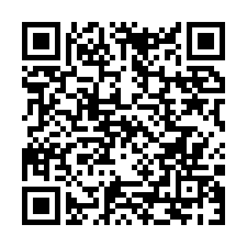

# Wiggle3DS

[English](README.md) · **Deutsch**

Retro-Foto- und Wiggle-Workstation für den New 3DS (XL). Sie nimmt mit beiden Außenkameras ein 3D-Foto auf und macht daraus ein Wigglegram-GIF, eine kleine Kamerafahrt wie bei den Nimslo- und Nishika-Kameras mit mehreren Linsen. Dazu kommen normale Fotos, Selfies, automatische Belichtung, ein automatischer Nachtmodus und 81 Filter von Classic über Datamosh bis Circuit Bending.

## Installieren

Scann den Code auf dem 3DS mit [FBI](https://github.com/lifehackerhansol/FBI): **Remote Install → Scan QR Code**. Er zeigt immer auf das neueste [Release](https://github.com/tj537/Wiggle3DS/releases/latest), FBI lädt die CIA direkt von GitHub und installiert sie.



Oder lad `Wiggle3DS.cia` vom [neuesten Release](https://github.com/tj537/Wiggle3DS/releases/latest), kopier sie auf die SD-Karte und installier sie in FBI. Deine Fotos in `Wiggle3DS/` bleiben bei Updates erhalten.

## Was sie kann

- **Wigglegrams:** Beide Außenkameras lösen gleichzeitig aus, du tippst auf dein Motiv, und die App macht ein wackelndes GIF, das sich um diesen Punkt dreht. Übergänge: Hard cut, Smooth, Extra smooth.
- **Normale Fotos:** Steht die Transition auf **Off**, wird die Aufnahme ein normales Foto (JPG). Beide Kamerabilder bleiben gespeichert, beim Bearbeiten machst du aus einem Foto jederzeit wieder ein Wiggle und umgekehrt.
- **81 Filter in Gruppen:** Classic, Color, RGB & Ghost, Tape & Screen, Data Mosh, Circuit Bending, Print & Pixel, Warp, Chaos (Deep Fried, Disco, Slit Scan, Kaleido, Droste, Shatter, Toxic, Hellfire, X-Ray …). Im Filtermenü zeigt jeder Filter eine Live-Vorschau deines Sucherbilds, mit X markierst du Favoriten, die haben einen eigenen Tab (All / ★ Favs, oder SELECT). Das große „Original“ oben bringt dich von überall in der Liste zurück zu ohne Filter, der Würfel daneben wählt einen Zufallsfilter. Die Glitch-Filter verändern das Bild selbst (RGB Split, VHS, Datamosh, Pixel Sort, Melt, Keyframe …), viele davon bewegen sich. Im GIF sind das zwei Wiggle-Durchläufe mit eigenem Muster, und genau die zeigt auch die Vorschau beim Bearbeiten.
- **Filterstärke:** jeder Filter von 0 bis 100 %, mit L und R in Schritten von 10 %.
- **Automatische Belichtung und Weißabgleich:** jedes Foto bekommt eine Tonkurve und einen Weißabgleich für beide Augen: Mitteltöne Richtung Mittelgrau, eine weiche Schulter, damit Lampen und Himmel nicht ausfressen, Farben großteils Richtung neutral (nur ein Stupser, wenn nichts im Bild grau ist, etwa Wiese unter blauem Himmel).
- **Belichtungskorrektur:** ☀ −2 bis +2 in halben Stufen, mit ZL ZR oder dem Regler oben links. Sie verschiebt die Belichtungsautomatik der Kamera, der Sucher zeigt es also schon, und die Entwicklung zielt darauf.
- **Nachtmodus, automatisch:** bleibt der Sucher dunkel, schaltet die Kamera selbst auf lange Belichtung (im Sucher und im Belichtungsregler erscheint ein Mond), und jedes Foto mittelt vier Bilder zu einem, das rauscht deutlich weniger. Bewegte Stellen bleiben vom ersten Bild, so gibt es keine Geisterbilder. Mit genug Licht geht er von selbst wieder aus; „Auto night“ in den Einstellungen schaltet ihn ganz ab.
- **Selfie:** die Innenkamera, gespiegelt, für normale Fotos.
- **Sauberes 3D:** Beide Sensoren sind synchronisiert, Helligkeit und Farbe des rechten Auges werden ans linke angeglichen, damit das GIF nicht flackert.
- **Galerie:** drei Reihen, die seitwärts scrollen, Mehrfachauswahl per Gedrückthalten, Löschen mit Rückgängig.
- **Aufs Handy:** QR-Code scannen, dann lädst du GIFs und Fotos im WLAN direkt aufs Handy.
- **Schnell:** GIFs und JPGs entstehen im Hintergrund, die Kamera ist sofort wieder bereit.

## Bedienung

Die App ist auf Englisch.

### Startscreen

Oben läuft der Sucher, unten sind deine Standards und die letzten Bilder.

- **A, L oder R:** auslösen
- **ZL ZR:** Belichtung dunkler / heller
- **▲:** Zufallsfilter
- **Y:** Filterauswahl. Antippen zeigt den Filter sofort im Sucher, nochmal Antippen oder A übernimmt ihn, L R stellt die Stärke ein, X macht ihn zum Favoriten.
- **B oder „All“:** Galerie
- **▶:** zu den letzten Bildern, dort wählst du mit ◀ ▶ und öffnest mit A
- **▼:** alle Standards zurücksetzen (Filter, Stärke, Transition, Speed, Quick capture, Selfie). Das geht auch mit dem Button oben links und in den Einstellungen unter „Capture defaults“.
- **SELECT:** aufs Handy teilen
- **START:** beenden

Oben, von links: die Akku-LED (grün, orange oder rot, mit Ring beim Laden), der Belichtungsregler (◀ dunkler, ▶ heller; ein Mond statt der Sonne, solange der Auto-Nachtmodus läuft), dann Zurücksetzen auf die Standards, Selfie, Share, Einstellungen.

Die Kacheln darunter sind die Standards für neue Aufnahmen: Filter, Transition (Off heißt Foto), Speed und Quick capture. Mit Quick capture wird jede Aufnahme sofort gespeichert, ohne vorher den Bearbeiten-Screen zu öffnen.

### Bearbeiten

- **Tippen aufs Motiv:** setzt den Drehpunkt, beim ersten Mal erklärt ein Hinweis das.
- **◀ ▶ oder der Regler:** Speed
- **▲ ▼:** Filter, **L R:** Filterstärke
- **X:** Transition, auch auf Off, dann wird es ein Foto
- **Y halten:** zeigt das Original ohne Filter
- **A:** speichern, **B:** zurück (fragt nach, wenn sonst etwas verloren ginge)

Das Original bleibt immer ungefiltert gespeichert, du kannst also alles später ändern.

### Galerie

- **Wischen:** scrollt mit Schwung
- **Steuerkreuz:** wählt ein Bild, **L R:** springt 4 Spalten
- **Antippen:** wählt ein Bild, **nochmal Antippen oder A:** öffnet es
- **Y:** abspielen oder pausieren
- **X:** löschen, danach ein paar Sekunden lang **Y** für Rückgängig
- **Bild gedrückt halten:** startet die Mehrfachauswahl, dann tippst du weitere an und löschst sie mit X

### Einstellungen

Farbschema, Selbstauslöser, Gitterlinien, Auslöseton, Blitz-Effekt, Sucher-fps, welche Kamera für Fotos (Standard rechts), Galerie-Autoplay, GIF-Größe (100 % oder 50 %, für Messenger), GIF-Form (4:3 oder 1:1), 3D-Datei (aus, MPO, Side-by-side) und Video (aus, MP4). Standardmäßig entsteht nur das GIF. Die Oberfläche kommt fast überall mit Symbolen statt Wörtern aus, damit sie in jeder Sprache funktioniert. Oben stehen die Version, die Anzahl der Aufnahmen und der freie Speicher. Alles landet in `Wiggle3DS/settings.txt`.

### Aufs Handy

SELECT oder Share zeigt oben einen QR-Code. Scannst du ihn mit dem Handy im selben WLAN, öffnet sich eine Seite mit allen GIFs und Fotos. Dort hältst du ein Bild gedrückt und wählst „Zu Fotos hinzufügen“, oder du tippst auf „Save“. Der Webserver (Port 8080) läuft nur, solange dieser Screen offen ist.

## Dateien auf der SD-Karte

- `Wiggle3DS/GIF/WIG_0001.gif`: ein fertiges Wigglegram, es läuft endlos
- `Wiggle3DS/GIF/WIG_0001.jpg`: ein Foto (Transition Off)
- `Wiggle3DS/GIF/WIG_0001.mp4`, `.mpo`, `_LR.jpg`: Video und 3D-Dateien, wenn in den Einstellungen an (MPO wie die 3DS-Kamera, für 3D-TVs; `_LR.jpg` linkes Auge links, für VR-Brillen)
- `Wiggle3DS/Photos/WIG_0001.w3d`: beide Kamerabilder mit allen Einstellungen, für die Galerie und zum neu Bearbeiten
- `Wiggle3DS/settings.txt`: die Einstellungen

## Bauen

Voraussetzung ist [devkitPro](https://devkitpro.org) mit dem Paket `3ds-dev`.

```bash
export DEVKITPRO=/opt/devkitpro DEVKITARM=/opt/devkitpro/devkitARM
make
```

Wichtig: Im Pfad zum Projektordner dürfen keine Leerzeichen sein, sonst bricht `make` ab.

## Zum Testen über den Homebrew Launcher

Öffne auf dem 3DS den Homebrew Launcher und drück **Y**. Dann am Mac:

```bash
/opt/devkitpro/tools/bin/3dslink Wiggle3DS.3dsx
```

Falls der 3DS nicht automatisch gefunden wird, häng die angezeigte IP-Adresse mit `-a <IP>` an. Für den Alltag ist die CIA unten besser.

## Als CIA ins HOME-Menü

Fertige Versionen installierst du als CIA mit [FBI](https://github.com/lifehackerhansol/FBI). Dann startet Wiggle3DS direkt aus dem HOME-Menü, mit eigenem Icon, Banner und Ton.

Zusätzlich brauchst du `makerom` ([Project_CTR](https://github.com/3DSGuy/Project_CTR/releases)) und `bannertool` ([3ds-bannertool](https://github.com/carstene1ns/3ds-bannertool)) im `PATH`, zum Beispiel in `~/.local/bin`. Dann:

```bash
make cia
```

Das erzeugt `Wiggle3DS.cia`. Die Title-ID ist fest (Unique ID `0xF57E3`, Product Code `CTR-H-WGLS`). Eine neue CIA ersetzt also die installierte Version, statt ein zweites Icon anzulegen. Für eine neue Version erhöhst du `APP_VERSION` im `Makefile` (und in `source/app.h`).

Vor dem Installieren musst du Wiggle3DS schließen. Deine Fotos und GIFs in `Wiggle3DS/` auf der SD-Karte bleiben dabei unverändert, auch beim Ersetzen oder Deinstallieren.

### Über WLAN

```bash
make send-cia
```

Der Mac baut die CIA, stellt sie im WLAN bereit (Port 8080) und zeigt im Terminal einen QR-Code mit der Adresse. Auf dem 3DS öffnest du FBI, wählst **Remote Install → Scan QR Code** und hältst die Kamera auf den QR-Code. Mac und 3DS müssen im selben WLAN sein. Der Server beendet sich, sobald der 3DS die Datei geladen hat.

Wenn der QR-Code im Terminal zu klein ist, öffnet `python3 tools/send-cia.py Wiggle3DS.cia --open` ihn groß im Browser.

Ohne QR-Code: Wähl in FBI **Remote Install → Receive URLs over the network**. FBI zeigt dann die IP des 3DS an. Am Mac:

```bash
make send-cia IP=192.168.x.y
```

### Über die SD-Karte

Kopier `Wiggle3DS.cia` auf die SD-Karte, zum Beispiel nach `cias/`. In FBI öffnest du **SD → cias**, wählst die Datei und dann **Install and delete CIA** (oder **Install CIA**).

### Veröffentlichen

Mit `make cia` bauen und `Wiggle3DS.cia` an ein neues GitHub-Release hängen. Der QR-Code oben muss nicht neu: Er zeigt immer aufs neueste Release. `make qr` schreibt ihn neu (`docs/install-qr.svg`), falls das Repository mal umzieht.

## Lizenz

MIT, siehe [LICENSE](LICENSE). Die Teile von anderen stehen unter ihren eigenen Lizenzen (unten).

## Fremder Code

- `source/qrcodegen.c/.h`: [QR Code generator](https://github.com/nayuki/QR-Code-generator) von Project Nayuki (MIT-Lizenz)
- `fonts/`: [Inter](https://github.com/rsms/inter) (SIL Open Font License)

## Werkzeuge

- `tools/genfont.swift` erzeugt `source/font_data.c` aus den Inter-Schriften in `fonts/` (SIL Open Font License):

  ```bash
  swift tools/genfont.swift source/font_data.c fontSmall:fonts/Inter-Medium.ttf:10.5 fontBody:fonts/Inter-SemiBold.ttf:12.5 fontTitle:fonts/Inter-Bold.ttf:19
  ```

- `tools/genmeta.swift` erzeugt Icon (48x48), Banner (256x128) und Banner-Ton in `meta/` aus den Inter-Schriften:

  ```bash
  swift tools/genmeta.swift meta
  ```

- `tools/send-cia.py` stellt die CIA im WLAN bereit (siehe oben). Den QR-Code baut `tools/qrtext.c` mit demselben qrcodegen wie die App. `tools/release-qr.py` schreibt den Installations-QR-Code.

- `make test` baut und startet `tools/test.c` am Rechner (Filter, Auto-Entwicklung, MP4- und MPO-Writer; mit installiertem ffmpeg wird das MP4 auch dekodiert) und `tools/preview.c`, das jeden Screen aus einem erfundenen Kamerapaar (`tools/testpair.py`) nach `build/test/*.bmp` zeichnet. GitHub Actions baut und testet bei jedem Push.
