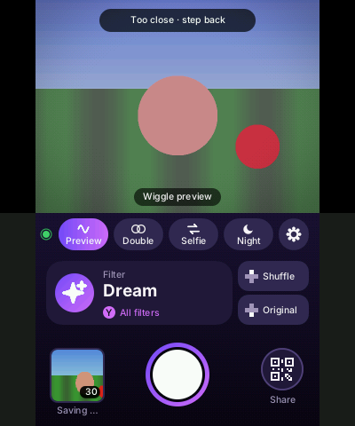
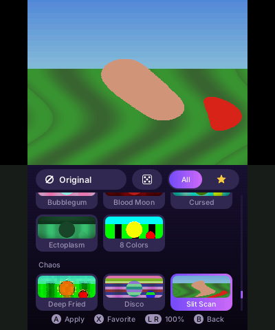
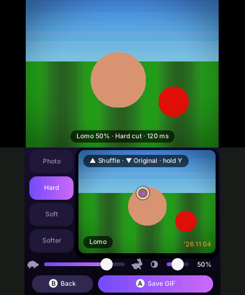
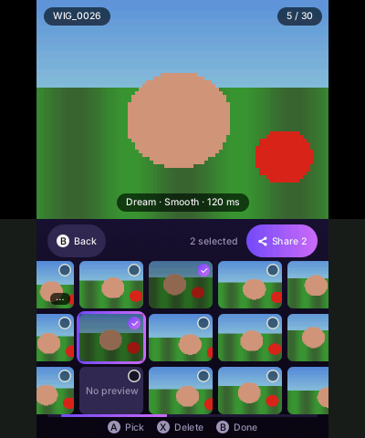
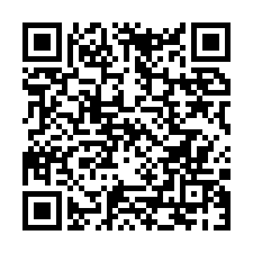

# Wiggle3DS

**Turn your 3DS into a wigglegram camera.**

Both outer cameras of the 3DS fire at the same moment. You tap your subject, and Wiggle3DS makes a looping GIF that rocks back and forth around it, like the old multi-lens Nimslo and Nishika cameras. Plus plain photos, selfies, 96 filters from film looks to full-on glitch chaos, and a way to get it all onto your phone in seconds.

[](https://github.com/tj537/Wiggle3DS/actions/workflows/build.yml)

| Home | Filters | Edit | Gallery |
|:---:|:---:|:---:|:---:|
|  |  |  |  |

*Screens drawn on the computer from a test picture; on the 3DS the top screen is your camera.*

---

## ⚠️ Read this first

**Wiggle3DS is homebrew.** It is not from Nintendo, it is not in the eShop, and it **does not run on a normal, unmodified 3DS.**

You need:

- ✅ A **3DS with custom firmware** (Luma3DS). If you don't have it yet, follow **[3ds.hacks.guide](https://3ds.hacks.guide)**, the one guide everyone uses. It is free and works on every firmware version. Take your time with it.
- ✅ **[FBI](https://github.com/lifehackerhansol/FBI)** to install apps. The guide above sets it up for you.
- ✅ An **SD card** with some free space (a photo with its GIF is about 2–4 MB).

Which consoles:

| Console | Works? |
|---|---|
| New 3DS XL / New 3DS | ✅ What it is made and tested on |
| New 2DS XL | 🟡 Should work (two outer cameras, no 3D screen), untested |
| Old 3DS / 3DS XL / 2DS | 🟡 May work, but slower; untested |
| Unmodded 3DS | ❌ No. You need custom firmware first. |
| Emulators (Citra, Lime3DS …) | ❌ No real cameras, so nothing to take pictures with |
| Switch, phones, PC | ❌ No |

> **Your console, your responsibility.** Modding is safe when you follow the guide step by step, but it is your decision and your risk. Never pay anyone for a "hacked 3DS" or a "homebrew kit": everything you need is free. Back up your SD card now and then, especially before updates.

---

## 🚀 Install (2 minutes)

You already have custom firmware and FBI? Then:

1. Make sure the 3DS is on **Wi-Fi**.
2. Open **FBI** → **Remote Install** → **Scan QR Code**.
3. Point the camera at this code:

   

4. Say **Yes** to install. Done: Wiggle3DS is now in your HOME Menu.

The code always points to the [newest release](https://github.com/tj537/Wiggle3DS/releases/latest), so the same code also updates the app. **Your photos are kept** when you update or even uninstall.

<details>
<summary>No Wi-Fi, or the QR code won't scan?</summary>

1. Download `Wiggle3DS.cia` from the [latest release](https://github.com/tj537/Wiggle3DS/releases/latest).
2. Put the SD card in your computer and copy the file into a folder called `cias` (make it if it isn't there).
3. SD card back into the 3DS, open **FBI** → **SD** → **cias** → `Wiggle3DS.cia` → **Install and delete CIA**.

</details>

---

## 📸 Your first wiggle

1. Open Wiggle3DS. The top screen is your viewfinder.
2. Hold the 3DS still and press **A**.
3. On the bottom screen, **tap your subject** (a face, a cup, a dog). That point stays still, everything else wiggles around it.
4. Slide from 🐢 to 🐇 for the speed, pick how soft the wiggle is, press **▲** for a random filter, **▼** for none.
5. Press **A** to save. The GIF is made in the background, you can shoot again right away.

**Tips for great wiggles:** have something close (1–2 m) and something far away. If you're too close, the viewfinder says **Too close · step back**. Want to see the wiggle before you shoot? Tap the wave button (or **◀**): the viewfinder wiggles live. In the dark, switch on night mode (the moon button, or **X**); it waits until you hold still, then takes four frames.

---

## ✨ What it can do

**Shooting**
- 🎞 **Wigglegrams** in three transitions: hard cut, smooth, extra smooth. Or switch the transition off for a **plain photo** (JPG). Both camera images are always kept, so you can change your mind later.
- ☀️ **Always well exposed:** every shot gets its own exposure and white balance, the same for both eyes so nothing flickers.
- 🌙 **Night mode:** one tap on the moon (or **X**): the camera exposes longer and each shot combines four frames into one, for much less noise.
- ◎ **Double exposure:** two shots on top of each other, like on film. The first one shows over the viewfinder so you can line up the second.
- 🤳 **Selfies** with the inner camera.
- 🎯 **Smart help:** the app warns when you're too close, shows the wiggle live before you shoot, and in night mode waits until you hold still.
- ⏱ Self-timer with ticking, grid lines, quick capture (saves every shot right away), a retro date stamp if you like.
- 🕶 **Made for the 3DS:** with the 3D slider up, messages and cards float in front of the picture.

**Filters**
- 🎨 **96 filters** with live previews: Classic, Color, RGB & Ghost, Tape & Screen, Data Mosh, Circuit Bending, Print & Pixel, Warp (Liquid, Ripple, Fisheye, Zoom Blur …), **Trip** (Psychedelic, Neon, Pixel Rain, LED Wall, Synthwave, Cursed …) and **Chaos** (Deep Fried, Disco, Slit Scan, Kaleido, Droste, Shatter, Toxic, Hellfire, X-Ray …).
- Many glitch filters **move**, and the GIF moves with them.
- ⭐ Favorites in their own tab, 🎲 a random filter, one big button back to **Original**.
- Any filter at any strength, 0–100 %.

**Sharing**
- 📱 **To your phone in seconds:** scan a QR code, a page with all your GIFs opens, long-press to save. No app, no cable.
- 🎬 Optional **MP4** of every wiggle, for WhatsApp, Instagram and friends.
- 🥽 Optional **3D files**: MPO (for 3D TVs and the 3DS photo app) or side-by-side (for VR viewers).

**And**
- 🖼 A gallery that scrolls sideways, select several, delete with undo.
- 🌈 Six color themes.

---

## 🎮 Controls

### Home (camera)

| Button | Does |
|---|---|
| **A** / **L** / **R** / **ZL** / **ZR** | Take a shot |
| **◀** | Wiggle preview on / off |
| **X** | Night mode on / off |
| **Y** | Filter menu |
| **▲** | Shuffle: a random filter |
| **▼** | Back to Original (no filter) |
| **B** | Gallery |
| **SELECT** | Send to your phone (also in the gallery) |
| **START** | Quit |

The touch screen, top to bottom: the switches (wiggle preview, double exposure, selfie, night, settings; a switch that is on lights up), the filter card with **Shuffle** and **Original** beside it (tap the card for all filters), and at the bottom your newest shot (opens the gallery), the big shutter button and the QR button that sends your shots to your phone. Transition, speed, quick capture and the date stamp for new shots are at the top of the settings.

With double exposure on, the first shot stays over the viewfinder; **A** takes the second, **B** drops the first.

### Filter menu

| Button | Does |
|---|---|
| Tap a filter | Preview it on the top screen; tap again to use it |
| **A** | Use the selected filter |
| **X** | Add to / remove from favorites ⭐ |
| **L** / **R** | Filter strength |
| **SELECT** | Switch between all filters and favorites |
| Dice | A random filter |
| **B** | Close |

### Edit

| Button | Does |
|---|---|
| Tap the picture | Set the point that stays still |
| 🐢 ─ 🐇 slider, or **◀ ▶** | Speed |
| Photo / Hard / Soft / Softer (left of the picture) | Photo makes a plain picture; the others set how the wiggle moves |
| ◐ slider | Filter strength |
| **▲** / **▼** | Shuffle / Original, like on home |
| **L** / **R** | Filter strength |
| **X** | Next transition step |
| Hold **Y** | Compare with the original |
| **A** / **B** | Save / back (it asks before anything gets lost) |

### Gallery

| Button | Does |
|---|---|
| Swipe or D-pad | Browse |
| Tap, then tap again or **A** | Open a shot |
| **Y** | Play / pause |
| **X** | Delete (press **Y** right after to undo) |
| Hold a shot | Select several |

---

## 📱 Get your pictures onto your phone

1. 3DS and phone on the **same Wi-Fi**.
2. On the 3DS press **SELECT** (works on the home screen and in the gallery), or tap **Share** at the top of the gallery. A QR code shows up.
3. Scan it with your phone's camera. A page with all your shots opens, newest first, sorted by day.
4. Tap a picture: it opens big (as a video if there is an MP4). Tap **Save GIF**, **Save MP4** or the 3D buttons, or press and hold the picture → **Save to Photos**.

Shots you saved get a ✓, so next time you see what's new. Want to send just a few? In the gallery, hold a shot, tap the others, then **Share** at the top: the page shows only those.

The page only works while the share screen is open on the 3DS. Small preview pictures are kept in `Wiggle3DS/Cache/` so the page loads fast; you can delete that folder any time.

---

## ⚙️ Settings

| Setting | What it's for |
|---|---|
| Theme | Six color schemes |
| Self-timer | Off, 3 s, 10 s |
| Grid lines | Rule-of-thirds lines in the viewfinder |
| Sounds / Capture flash | Shutter, taps, self-timer ticks; white flash when you shoot |
| Viewfinder | 15, 20 or 30 fps; lower saves battery |
| Photo camera | Which outer camera takes plain photos |
| Gallery autoplay | Play GIFs right away in the gallery |
| GIF size | 100 % or 50 % (smaller files for messengers) |
| GIF shape | 4:3 or square |
| Date stamp | The date in orange in the corner, like an old film camera |
| 3D file | Off, MPO, or side-by-side |
| Video | Off or MP4 |
| Capture defaults | Reset filter, speed and modes |

---

## 💾 Where your files are

Everything is on the SD card in the `Wiggle3DS` folder:

| File | What it is |
|---|---|
| `GIF/WIG_0001.gif` | Your wigglegram |
| `GIF/WIG_0001.jpg` | A plain photo |
| `GIF/WIG_0001.mp4` | The video (if switched on) |
| `GIF/WIG_0001.mpo`, `GIF/WIG_0001_LR.jpg` | 3D files (if switched on) |
| `Photos/WIG_0001.w3d` | Both original camera images, to edit again later |
| `Cache/WIG_0001.jpg` | Small pictures for the share page (safe to delete) |
| `settings.txt` | Your settings |

---

## 🛟 Help

**"I scanned the QR code with my phone and nothing happens."**
The install code is for **FBI on the 3DS**, not for your phone.

**FBI says it can't download.**
Check that the 3DS is on Wi-Fi. If it still fails, use the SD card way above.

**The camera shows ✕ / stays black.**
Close the app and open it again. Make sure no other app is using the camera, and that the lenses aren't covered.

**My shots are dark / noisy at night.**
Switch on night mode (moon button or **X**) and hold the console really still while "Hold still" shows: it takes four frames. A table or wall to rest it on helps a lot.

**The GIF is too big for WhatsApp.**
Settings → GIF size → 50 %, or switch on Video → MP4 and send that.

**How do I update?**
Scan the same install code again in FBI. Your photos stay.

**How do I uninstall?**
FBI → **Titles** → Wiggle3DS → **Delete Title**. Your photos stay on the SD card in `Wiggle3DS/` until you delete them.

Found a bug? [Open an issue](https://github.com/tj537/Wiggle3DS/issues) and say which console you have.

---

## 🛠 For developers

<details>
<summary>Building, installing from your computer, tests</summary>

### Build

You need [devkitPro](https://devkitpro.org) with the `3ds-dev` package.

```bash
export DEVKITPRO=/opt/devkitpro DEVKITARM=/opt/devkitpro/devkitARM
make
```

The path to the project folder must not contain spaces.

### Run without installing

Open the Homebrew Launcher on the 3DS and press **Y**, then:

```bash
/opt/devkitpro/tools/bin/3dslink Wiggle3DS.3dsx
```

If the 3DS isn't found, add `-a <IP>` with the address it shows.

### Build and install the CIA

You also need `makerom` ([Project_CTR](https://github.com/3DSGuy/Project_CTR/releases)) and `bannertool` ([3ds-bannertool](https://github.com/carstene1ns/3ds-bannertool)) in your `PATH`.

```bash
make cia
```

The title ID is fixed (unique ID `0xF57E3`, product code `CTR-H-WGLS`), so a new CIA replaces the installed one. For a new version, raise `APP_VERSION` in the `Makefile` and in `source/app.h`.

To install it over Wi-Fi straight from your computer:

```bash
make send-cia
```

It serves the CIA on the local network (port 8080) and prints a QR code; scan it with FBI → **Remote Install** → **Scan QR Code**. `python3 tools/send-cia.py Wiggle3DS.cia --open` shows the code large in the browser. Without a camera: FBI → **Remote Install** → **Receive URLs over the network**, then `make send-cia IP=<3DS IP>`.

### Tests

```bash
make test
```

Builds and runs `tools/test.c` on the computer (filters, auto develop, the MP4 and MPO writers; with ffmpeg installed it also decodes the MP4) and `tools/preview.c`, which draws every screen into `build/test/*.bmp` from a made-up camera pair (`tools/testpair.py`). GitHub Actions runs the build and the tests on every push.

### Release

`make cia`, then attach `Wiggle3DS.cia` to a new GitHub release. The install QR code always points to the latest release; `make qr` writes it again (`docs/install-qr.svg`) should the repository move.

### Code map

| File | What's in it |
|---|---|
| `source/main.c` | App loop, input, capture |
| `source/ui*.c` | Screens: `ui.c` shared parts and top screen, `ui_home.c`, `ui_gallery.c`, `ui_settings.c` |
| `source/icons.c` | Small icons, usable as characters in any text |
| `source/filter.c` | All filters; ids in `filter.h` are stored in shots, only ever add at the end |
| `source/develop.c` | Night stacking, double exposure, eye matching, auto exposure and white balance |
| `source/export.c` | Background thread making GIF, JPG, MP4 and 3D files |
| `source/gif.c`, `jpeg.c`, `mp4.c`, `stereo.c` | File writers |
| `source/share.c` | The web page for your phone |

### Other tools

- `tools/genfont.swift` makes `source/font_data.c` from the Inter fonts in `fonts/`:
  `swift tools/genfont.swift source/font_data.c fontSmall:fonts/Inter-Medium.ttf:10.5 fontBody:fonts/Inter-SemiBold.ttf:12.5 fontTitle:fonts/Inter-Bold.ttf:19`
- `tools/genmeta.swift` makes the HOME Menu icon, banner and banner sound in `meta/`: `swift tools/genmeta.swift meta`
- `tools/qrtext.c` makes QR codes with the app's own qrcodegen; `tools/release-qr.py` writes the install code.

</details>

---

## 📄 License and credits

MIT, see [LICENSE](LICENSE).

- QR codes: [QR Code generator](https://github.com/nayuki/QR-Code-generator) by Project Nayuki (MIT)
- Font: [Inter](https://github.com/rsms/inter) (SIL Open Font License)

Wiggle3DS is a fan-made homebrew app and has nothing to do with Nintendo.
